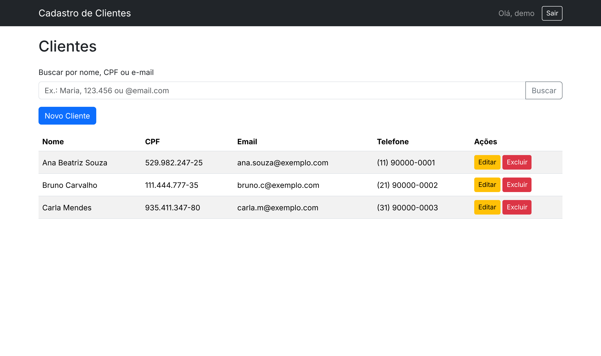
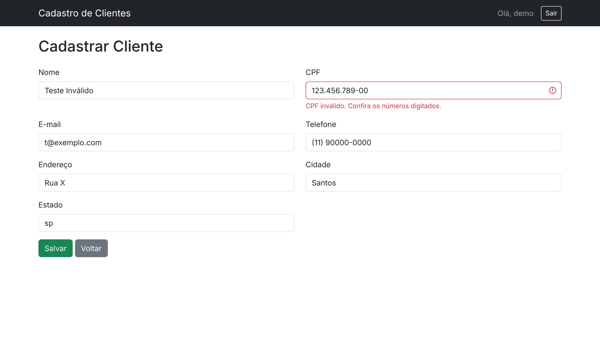
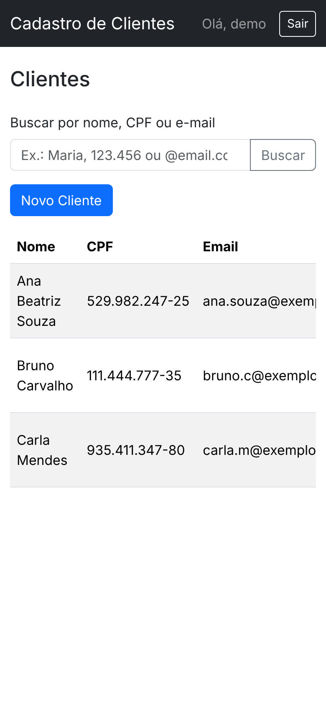

# CRUD de Cadastro de Clientes

Aplicação web em **Python + Django + MySQL** para cadastrar, buscar, editar e excluir clientes, com acesso restrito por login e validação de CPF.

Foi o meu primeiro projeto completo com Django: modelo, formulário, views, rotas, templates e banco relacional, do zero até o CRUD funcionando.

<p>
  
</p>

> Todas as imagens usam **dados fictícios**.

## Funcionalidades

- **Login obrigatório:** o sistema guarda dados pessoais (CPF, e-mail, telefone, endereço), então nenhuma tela de clientes abre sem autenticação.
- **Cadastro, listagem, edição e exclusão** de clientes. A exclusão sempre pede confirmação e só acontece por `POST`.
- **Busca** por nome, CPF ou e-mail, sem diferenciar maiúsculas e minúsculas.
- **Validação de CPF** pelos dígitos verificadores. O CPF é gravado sempre no formato `000.000.000-00`, então a regra de CPF único vale com ou sem pontuação.
- Mensagens de confirmação após cada ação e erros exibidos ao lado do campo, ligados a ele para leitores de tela.
- Layout responsivo com Bootstrap 5.

| Validação de CPF | No celular |
|---|---|
|  |  |

## Tecnologias

| Camada | Tecnologia |
|---|---|
| Linguagem | Python 3.13 |
| Framework | Django 5.2 (LTS) |
| Banco de dados | MySQL 8 (driver `mysqlclient`); SQLite opcional para testes |
| Interface | Templates do Django + Bootstrap 5 |
| Configuração | Variáveis de ambiente via `.env` (`python-dotenv`) |
| Testes e CI | `django.test` + GitHub Actions com MySQL |

## Estrutura

```
cadastro_clientes/        configuração do projeto (settings, rotas principais)
clientes/
  models.py               modelo Cliente
  validators.py           validação e formatação do CPF
  forms.py                formulário (normaliza CPF e UF, destaca erros)
  views.py                listar/buscar, cadastrar, editar, excluir (todas com login)
  urls.py                 rotas do app
  templates/              base, telas de clientes e tela de login
  migrations/             histórico do banco
  tests.py                testes automatizados
docs/img/                 capturas de tela (dados fictícios)
.env.example              modelo das variáveis de ambiente (sem valores reais)
```

## Como executar

Pré-requisitos: Python 3.11+ e um servidor MySQL (ou use SQLite para testar rapidamente).

```bash
python -m venv .venv
# Windows: .venv\Scripts\activate   |   Linux/macOS: source .venv/bin/activate
pip install -r requirements.txt
```

**1. Configure o ambiente.** Copie `.env.example` para `.env` e preencha os seus valores:

```bash
cp .env.example .env
```

| Variável | Para que serve |
|---|---|
| `DJANGO_SECRET_KEY` | Chave secreta do Django. Gere uma nova (o comando está no `.env.example`). Obrigatória quando `DJANGO_DEBUG=False`. |
| `DJANGO_DEBUG` | `True` só no desenvolvimento local |
| `DJANGO_ALLOWED_HOSTS` | Endereços aceitos, separados por vírgula |
| `DB_ENGINE` | `mysql` (padrão) ou `sqlite` |
| `DB_NAME`, `DB_USER`, `DB_PASSWORD`, `DB_HOST`, `DB_PORT` | Conexão com o MySQL |

**2. Crie o banco no MySQL** (pule se usar `DB_ENGINE=sqlite`):

```sql
CREATE DATABASE cadastro_clientes CHARACTER SET utf8mb4;
```

**3. Aplique as migrações e crie um usuário para entrar no sistema:**

```bash
python manage.py migrate
python manage.py createsuperuser
```

**4. Inicie o servidor** e acesse http://127.0.0.1:8000:

```bash
python manage.py runserver
```

Novos usuários podem ser criados pelo painel administrativo do Django, em `/admin/`.

## Testes

```bash
python manage.py test
```

São 20 testes cobrindo validação de CPF, login obrigatório em todas as telas, busca, cadastro, edição, exclusão com confirmação e respostas 404. Eles rodam no GitHub Actions a cada push, com um MySQL temporário. Localmente também rodam com `DB_ENGINE=sqlite`.

## Segurança

- Nenhuma senha ou chave fica no código: tudo vem do `.env`, que não é versionado.
- Telas de clientes protegidas por login. Logout só por `POST`. Proteção CSRF do Django em todos os formulários.
- Fora do modo de desenvolvimento, os cookies de sessão e CSRF só trafegam por HTTPS.
- **Histórico:** versões antigas deste repositório tinham a chave de desenvolvimento do Django escrita no `settings.py`. Ela continua visível no histórico do Git e **não deve ser usada**. Gere sempre uma chave nova no seu `.env`.

## Limitações conhecidas

- Não há cadastro público de usuários nem perfis de permissão: todo usuário autenticado pode ver e alterar todos os clientes.
- CPFs gravados antes da validação não foram reformatados. Eles são conferidos e padronizados na próxima vez que o cliente for editado.
- Projeto de estudo: não há configuração de deploy em produção (servidor WSGI, arquivos estáticos, HTTPS).

## Como este projeto foi feito

A versão inicial (modelo, formulário, views, templates e conexão com MySQL) foi desenvolvida por mim em maio de 2026, durante os estudos de Django.

Em novembro de 2026, fiz uma revisão do projeto **com auxílio do Claude (IA da Anthropic)**, registrada no histórico como coautoria: login obrigatório, validação de CPF, busca, configurações por variáveis de ambiente, migração pendente, testes automatizados e CI. Revisei e testei essas mudanças antes de incorporá-las.
